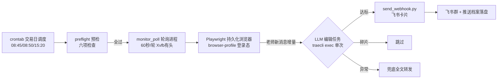

# 直播监控方案

> 对象：和讯财道「复盘哥专栏 VIP直播室」（房间 11605）的无人值守盯盘与推送。
> 2026-11-09 实盘首日验证后成文；运维命令见根目录 `Makefile`，部署细节见 `docs/ops/deploy.md`。

## 一、系统架构

### 1.1 数据流总览

> 交互式架构图（可缩放/聚焦/主题切换）：[直播监控架构.html](直播监控架构.html)（由 [architecture.json](architecture.json) 经 archify 生成，含主链路/采集登录/记忆配置三个聚焦视图）。



### 1.2 五类组件的具体位置与作用

**① 脚本层（确定性执行，零智能）**——`scripts/monitor/`（分组见 `docs/脚本功能说明.md`）：

| 脚本 | 架构位置 | 作用 |
|------|---------|------|
| `core/monitor_poll.py` | **主循环/调度中枢** | 60s 轮询页面、增量识别（游标+哈希双去重）、组装 context、触发 LLM 任务、兜底转发、心跳与游标落盘、浏览器自愈重建 |
| `preflight.sh` | 启动闸门 | 六项预检，不过不启动 |
| `force_cleanup.sh` | 收盘回收 | 15:20 杀残留进程 |
| `.trae/skills/live-monitor/scripts/send_webhook.py` | 推送出口 + 档案写入口 | 卡片格式化、发送、**成功后自动落盘 pushes 档案** |
| `login/*`（6 个） | 登录恢复工具箱 | 滑块识别 / 续期验证 / 验证码回传 / profile 打包 / noVNC 应急 |
| `legacy-agent/*` | 备用执行器 | 常驻 traecli agent 模式（launcher/watchdog，现停用） |

脚本层的原则：**所有需要"可靠"的事情都在这层**（重试、去重、自愈、落盘），不依赖 LLM 的自觉。

**② LLM 层（智能判断，零状态）**——traecli exec 单次编辑任务：

- 架构位置：**无状态的判断函数**——输入 context，输出动作（推送/跳过），进程结束即消失；
- 承担全部"需要理解"的事情：七类分类、碎片识别、话题合并、去废话、格式化；
- 刻意设计：每任务全新 `--session-id`，**不使用任何跨任务会话记忆**（常驻会话实测不可靠）；同一个判断给两个独立任务结果一致（分类定义在 prompt 里写死）。

**③ context（LLM 任务的输入组装）**——每次编辑任务的完整输入就三样：

| 组成 | 来源 | 内容 |
|------|------|------|
| 编辑指令 | `EDITOR_PROMPT`（monitor_poll 内嵌） | 七类定义全文 + 任务流程 + 输出协议 `{pushed, skipped}` |
| 当批消息 | `tmp/pending_msgs.json` | 本轮新捕获的老师消息 JSON（时间 + 原文） |
| 参考指引 | prompt 中指向 `.trae/skills/live-monitor/memory.md` | agent 可自行读分类体系原文与格式规范 |

**不进 context 的**：历史消息（不需要——增量设计）、历史会话（没有——全新 session）、凭据（PAT 在进程环境变量，不进 prompt）、webhook 地址（agent 只调脚本，不接触地址）。

**④ 本地持久化（系统的全部记忆）**——`runtime/`：

| 文件 | 作用 | 谁写 | 谁读 |
|------|------|------|------|
| `messages/{日期}.jsonl` | 当日消息全量原文档案 | monitor_poll 每轮 | 启动时恢复去重集合；人工回溯 |
| `pushes/{日期}.jsonl` | 整理成品全文（Markdown） | send_webhook 推送成功后 | 同上；推送节奏回看 |
| `state.json` | 游标 msg_cursor_total / auth_status / 统计 | monitor_poll | preflight、make status、次日续跑 |
| `heartbeat` | 存活心跳 | monitor_poll 每轮 | 看门狗（备用模式） |
| `sms_code.txt` | 验证码人机接力 | `make auth-input-code` | 登录流程轮询，用后即删 |
| `browser-profile/` | 登录态 Cookie（Chromium user-data-dir） | 登录流程 | 轮询浏览器，跨日复用 |
| `auth_history.jsonl` | 登录/续期历史（Cookie 寿命观测） | 登录流程 | 运维 |

**跨日边界**：runtime 档案按日切割，只服务当日运行与去重；跨日的知识沉淀交给 fupan-ge-wiki 的 collect→distill（消费 `直播课/history/`），本系统不越界。

**⑤ memory（两份人写的配置 + 一份刻意的"无记忆"）**：

| 形态 | 位置 | 性质 |
|------|------|------|
| 运行配置 memory.md | `.trae/skills/live-monitor/memory.md`（webhook/手机号/分类体系/时间节奏）、`.trae/skills/hexun-live-login/memory.md`（手机号） | **人写机读**：敏感配置 + 分类权威定义；LLM 任务与脚本共同引用；git 忽略 |
| 项目指令 | `AGENTS.md`、`.trae/skills/*/SKILL.md`、`scripts/monitor/README.md` | 面向 agent 与维护者的行为规范（工程边界、密钥红线、工作流） |
| traecli 会话记忆 | `~/.trae/` 会话存储 | **刻意不用**：编辑任务全新 session、不 resume（常驻/恢复实测不可靠）——系统记忆全部由 runtime 档案承担，与模型会话解耦 |

### 1.3 一次推送的完整数据流（以一条干货消息为例）

```
老师发言（直播页）
 → [脚本] monitor_poll 60s 轮询提取，哈希查重确认新消息
 → [持久化] 立即归档 messages/{日期}.jsonl（先存后处理，崩溃不丢）
 → [context] 该消息进 pending_msgs.json，与 EDITOR_PROMPT 组装
 → [LLM] traecli exec：读 prompt+消息 → 分类判断（如 💡交易技巧）→ 整理 Markdown
 → [脚本] agent 调 Bash 执行 send_webhook.py '<markdown>'
 → [推送] 飞书卡片送达用户群
 → [持久化] send_webhook 成功后自动落盘 pushes/{日期}.jsonl（全文+哈希）
 → [脚本] monitor_poll 记录本轮统计，touch heartbeat，游标写 state.json
（任一 LLM 环节失败 → 同一消息降级全文转发，保证送达）
```

### 1.4 设计原则一句话

**脚本管可靠（重试/去重/自愈/落盘），LLM 管判断（分类/合并/提炼），runtime 档案管记忆，memory.md 管配置——四者各司其职，互不越界；模型会话被刻意排除在架构之外。**

## 二、盘中监控

### 轮询机制

- **频率**：60 秒/轮（盘中）；连续 12 轮无新消息（total 不变）刷新页面一次（MQTT 断连自愈）。
- **提取**：每轮取最近 40 条，`total`（消息总数）为游标；增量 = `index >= 上轮 total` 且内容哈希未见过。
- **双去重**：index 游标防重复处理 + MD5 哈希集合防 MQTT 补发旧消息重复推送；哈希集合启动时从当日档案恢复（跨重启有效，见第三节持久化表）。
- **登录态监测**：每轮检测登录表单是否出现（出现即登录失效信号，人工模式下按登录恢复 SOP 处理）。

### 时段节奏（SKILL 约定，当前实现为固定 60s，待细化）

| 时段 | 建议频率 | 重点关注 |
|------|---------|---------|
| 09:15-09:30 | 1-2 分钟 | 🔔 竞价异动、一字板方向 |
| 09:30-11:30 | 2-5 分钟 | 开盘方向、板块异动、干货 |
| 11:30-13:00 | 10-15 分钟 | 午休降频 |
| 13:00-14:30 | 3-5 分钟 | 午后方向、回流切换 |
| 14:30-15:00 | 2-3 分钟 | 尾盘异动、次日预案 |
| 15:00-15:15 | 5 分钟 | 盘后总结观察 |

### 自愈机制

- **浏览器崩溃**：单轮失败重试 goto，连续 3 轮失败整 context 重建（2026-11-09 10:40 崩溃 5 小时未恢复的教训——原版只重试 goto 不重建，死循环空转）。
- **消息停更**：连续 12 轮 total 不变自动 reload。
- **编辑任务失败**：该批消息降级为全文转发（去人名），保证内容不漏，质量降级不中断。

## 三、信息归纳

### 分类体系（7 类）

| 分类 | Emoji | 推送时机 | 判断要点 |
|------|-------|---------|---------|
| 交易机会 | 🎯 | 立即 | 明确可关注方向/板块/个股/买点节点 |
| 风险提示 | ⚠️ | 立即 | 走弱信号、回避方向、仓位警示 |
| 行情播报 | 📊 | 完整梳理才推 | 板块梳理（10点/午盘/收盘）、指数判断、连板结构 |
| 交易技巧 | 💡 | **话题讲完再推** | 方法论、模式、心态；严禁边讲边推 |
| 新闻催化 | 📰 | 有内容才推 | 政策、外围、行业事件 |
| 案例分析 | 📋 | 有内容才推 | 个股/板块走势拆解 |
| 竞价异动 | 🔔 | 竞价时段 | 一字板、竞价涨幅、方向选择 |

### 推送铁律

1. **绝不出现人名**（观点直接呈现，不透露来源）；
2. 同一话题多条消息**合并成一条**；
3. 同一观点不重复推，有新进展才更新；
4. 碎片互动、寒暄、免责声明**不推**（2026-11-09 实测：编辑任务对「个股指代不明、话未说完」的消息正确跳过）；
5. 质量优先于频率：重要干货多推，没价值一条不推。

### 编辑任务实现（prompt 分类机制）

每批老师新消息触发一个**独立的 traecli 单次进程**（`traecli exec "<编辑指令>"`，非交互、带 PAT、stdin 关闭、外部 300s 超时）。

**分类靠 prompt 完成**：编辑指令（`scripts/monitor/core/monitor_poll.py` 的 `EDITOR_PROMPT`）内嵌完整分类定义——七类的触发条件与判断要点逐条写明，并指示 agent 参考 `.trae/skills/live-monitor/memory.md` 的分类体系原文。任务流程：读 `tmp/pending_msgs.json`（当批消息 JSON）→ 逐条判断分类 → 碎片跳过/同话题合并 → 达标内容整理成 Markdown（去人名、要点化、个股带代码）→ 立即用 Bash 调 `send_webhook.py` 推送 → 输出一行 `{pushed, skipped}` 统计。**分类智能在模型侧，工程侧只负责触发与兜底**（编辑失败降级全文转发）。

> 为何不用常驻 agent：2026-11-09 实测 traecli 循环会话的推送环节不可靠（过程输出不可见、resume 并发静默）；单次短任务稳定（当日验证 10+ 次）。

### 当日持久化（三份档案）

| 档案 | 内容 | 写入方 |
|------|------|--------|
| `runtime/messages/{日期}.jsonl` | **当日消息全量原文**（含学员消息；每条 index + 内容哈希 + 全文），崩溃/重启后可回溯 | monitor_poll 每轮增量归档 |
| `runtime/pushes/{日期}.jsonl` | **整理成品全文**（标题 + 内容哈希 + 完整 Markdown），本地档案与跨重启去重双用途 | send_webhook 推送成功后自动落盘 |
| `tmp/poll_out.jsonl` | 轮询过程记录（total/登录态/增量/错误），调试用 | monitor_poll 每轮 |

**跨重启去重**：轮询进程启动时从当日 messages + pushes 两份档案恢复已处理内容哈希集合——MQTT 补发的旧消息、重启前已推过的内容不会重复推送（2026-11-09 上午重启重推竞价/梳理的教训修复）。

**历史整理信息的保留**：`pushes/{日期}.jsonl` 按日累积全部整理成品（Markdown 全文），可随时回看任意一天的推送内容与节奏；`state.json` 的 `msg_cursor_total` 保留当日游标。跨日的抽象沉淀（交易模式、板块档案等）不在本系统范围——由 fupan-ge-wiki 的 collect → distill 链路消费 `直播课/history/` 与快照后写入知识库（见第八节演进方向第 5 条）。

## 四、推送链路

- **渠道**：飞书群机器人 webhook（`open.feishu.cn/open-apis/bot/v2/hook/...`），存于**项目根 `.env`**（`FUPANGE_LIVE_MONITOR_WEBHOOK`，600 权限、git 忽略）；加载优先级：环境变量 > `.env` > memory.md（旧方式兼容）。
- **格式**：交互卡片——标题栏 = 分类 emoji + 时间 + 主题，按分类自动配色（🎯绿 / ⚠️红 / 📊蓝 / 💡橙 / 🔔紫 / 📰灰 / 📋青）；正文 = markdown 组件（粗体/引用/列表原生渲染）。
- **兼容**：send_webhook 按域名自动分流，企微 webhook（markdown 格式）仍支持。

## 五、登录与会话

- **登录方式**：手机号 + 短信验证码（和讯仅支持此方式），登录框在 `reg.homeway.com.cn` iframe 内。
- **登录态**：Cookie 持久化于 `runtime/browser-profile`，跨日复用（有效期以周计，失效时走恢复流程）。
- **验证码人机协作**：脚本发起验证码 → 用户在对话中回传 → 写入 `runtime/sms_code.txt`（`make auth-input-code CODE=xxx`）→ 脚本轮询读取完成登录（spec FR-3A）。
- **风控对抗**：网易易盾。无头模式被拦截（SDK 加载但弹层不渲染），必须 **Xvfb 有头**；发码多为智能无感知直过，登录可能触发滑块（`captcha_solver.py` ddddocr 缺口识别 + 拟人轨迹，重试 3 次降级）。
- **会话约束**：发码与登录必须在**同一浏览器会话**内完成（前端状态绑定，跨会话报「请先发送短信验证码」）。

## 六、调度与运维

- **crontab**（交易日）：09:05 preflight 预检 → 09:10 启动 → 15:20 兜底回收；PAT 凭据与 PATH 在 cron 行内注入。
- **preflight 六项**：交易日判断（API 异常按工作日放行）、traecli PAT 探活、浏览器 profile 含 Cookie、直播站连通、磁盘、memory.md 配置完整性。
- **运维入口**：`make help`（全部命令）、`make status`（游标/心跳/推送统计）、`make logs`、`make preflight`。

## 七、已知问题与教训（2026-11-09 实盘首日）

| 问题 | 根因 | 处置 |
|------|------|------|
| traecli 全部「答非所问」 | `exec` 子命令不存在（spec 设计误设） | 根命令 `-p` 非交互模式 |
| agent 静默退出 | `-o` 参数不存在 | 移除 |
| launcher 拉起即死 | make recipe 结束清理子进程 | `setsid nohup` 后台化 |
| 常驻 agent 轮询正常但不推送 | traecli 会话机制（过程不可见/并发静默） | 改「轮询 + 单次编辑任务」架构 |
| 10:40 后下午无监控 | Chromium 崩溃，恢复逻辑只重试 goto 不重建 | 连续 3 错整 context 重建 |
| 重复推送竞价/梳理 | MQTT 补发 + 无内容去重 | MD5 哈希集合去重 |
| pkill 自匹配误杀自身命令 | 模式串出现在复合命令行内 | 拼接模式串 + 与文件名引用隔离 |

## 八、演进方向

1. **轮询进程 systemd 化**：开机自启 + 崩溃自动重启（替代 cron 单点 + 自建重建）；
2. **常驻 agent 复活**：traecli 会话机制稳定后切回（减少每批一次的进程/token 开销）；
3. **定时摘要节点**：10:00 / 11:30 / 15:05 固定摘要与收盘健康度报告（当前仅事件驱动）；
4. **智能降频**：按 SKILL 时段表动态调整轮询间隔与午休降频；
5. **盘后沉淀**：当日推送与快照接入 fupan-ge-wiki 的 collect → distill 知识库链路（`runtime/snapshots/` 文件契约已预留）。
