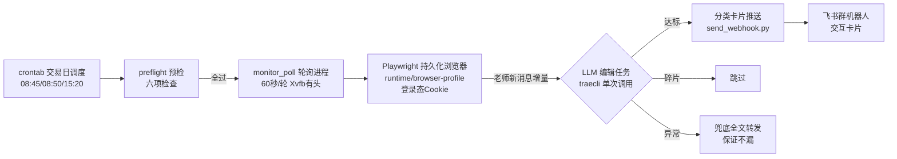

# 直播监控方案

> 对象：和讯财道「复盘哥专栏 VIP直播室」（房间 11605）的无人值守盯盘与推送。
> 2026-11-09 实盘首日验证后成文；运维命令见根目录 `Makefile`，部署细节见 `docs/ops/deploy.md`。

## 一、系统架构

三层分工：

| 层 | 载体 | 职责 |
|----|------|------|
| 采集层 | Playwright + Xvfb 有头 Chromium（登录态 profile） | 滚动到底、提取 `.pointList.msglay` 消息、增量识别（index 游标 + 内容哈希双去重） |
| 归纳层 | traecli 单次编辑任务（每批新消息一个独立进程） | 按 7 类分类判断、去废话、话题合并、格式化 |
| 推送层 | send_webhook.py（标准库） | 飞书交互卡片（markdown 组件 + 分类配色），企微格式保留 |

## 二、盘中监控

### 轮询机制

- **频率**：60 秒/轮（盘中）；连续 12 轮无新消息（total 不变）刷新页面一次（MQTT 断连自愈）。
- **提取**：每轮取最近 40 条，`total`（消息总数）为游标；增量 = `index >= 上轮 total` 且内容哈希未见过。
- **双去重**：index 游标防重复处理 + MD5 哈希集合防 MQTT 补发旧消息重复推送（2026-11-09 实战教训）。
- **登录态监测**：每轮检测登录表单是否出现（出现即登录失效信号，人工模式下按登录恢复 SOP 处理）。

### 时段节奏（SKILL 约定，当前实现为固定 60s，待细化）

| 时段 | 建议频率 | 重点关注 |
|------|---------|---------|
| 09:15-09:30 | 1-2 分钟 | 🔔 竞价异动、一字板方向 |
| 09:30-11:30 | 2-5 分钟 | 开盘方向、板块异动、干货 |
| 11:30-13:00 | 10-15 分钟 | 午休降频 |
| 13:00-14:30 | 3-5 分钟 | 午后方向、回流切换 |
| 14:30-15:00 | 2-3 分钟 | 尾盘异动、次日预案 |
| 15:00-15:15 | 5 分钟 | 盘后总结观察 |

### 自愈机制

- **浏览器崩溃**：单轮失败重试 goto，连续 3 轮失败整 context 重建（2026-11-09 10:40 崩溃 5 小时未恢复的教训——原版只重试 goto 不重建，死循环空转）。
- **消息停更**：连续 12 轮 total 不变自动 reload。
- **编辑任务失败**：该批消息降级为全文转发（去人名），保证内容不漏，质量降级不中断。

## 三、信息归纳

### 分类体系（7 类）

| 分类 | Emoji | 推送时机 | 判断要点 |
|------|-------|---------|---------|
| 交易机会 | 🎯 | 立即 | 明确可关注方向/板块/个股/买点节点 |
| 风险提示 | ⚠️ | 立即 | 走弱信号、回避方向、仓位警示 |
| 行情播报 | 📊 | 完整梳理才推 | 板块梳理（10点/午盘/收盘）、指数判断、连板结构 |
| 交易技巧 | 💡 | **话题讲完再推** | 方法论、模式、心态；严禁边讲边推 |
| 新闻催化 | 📰 | 有内容才推 | 政策、外围、行业事件 |
| 案例分析 | 📋 | 有内容才推 | 个股/板块走势拆解 |
| 竞价异动 | 🔔 | 竞价时段 | 一字板、竞价涨幅、方向选择 |

### 推送铁律

1. **绝不出现人名**（观点直接呈现，不透露来源）；
2. 同一话题多条消息**合并成一条**；
3. 同一观点不重复推，有新进展才更新；
4. 碎片互动、寒暄、免责声明**不推**（2026-11-09 实测：编辑任务对「个股指代不明、话未说完」的消息正确跳过）；
5. 质量优先于频率：重要干货多推，没价值一条不推。

### 编辑任务实现

每批老师新消息触发一个**独立的 traecli 单次进程**（`traecli -p "<编辑指令>"`，非交互、带 PAT）：读消息 → 逐条分类 → 达标内容调 send_webhook 推送 → 输出 `{pushed, skipped}` 统计。

> 为何不用常驻 agent：2026-11-09 实测 traecli 循环会话的推送环节不可靠（过程输出不可见、resume 并发静默）；单次短任务稳定（当日验证 5+ 次）。待 traecli 会话机制稳定后可切回常驻模式。

## 四、推送链路

- **渠道**：飞书群机器人 webhook（`open.feishu.cn/open-apis/bot/v2/hook/...`），存于 `.trae/skills/live-monitor/memory.md`（600 权限、git 忽略）。
- **格式**：交互卡片——标题栏 = 分类 emoji + 时间 + 主题，按分类自动配色（🎯绿 / ⚠️红 / 📊蓝 / 💡橙 / 🔔紫 / 📰灰 / 📋青）；正文 = markdown 组件（粗体/引用/列表原生渲染）。
- **兼容**：send_webhook 按域名自动分流，企微 webhook（markdown 格式）仍支持。

## 五、登录与会话

- **登录方式**：手机号 + 短信验证码（和讯仅支持此方式），登录框在 `reg.homeway.com.cn` iframe 内。
- **登录态**：Cookie 持久化于 `runtime/browser-profile`，跨日复用（有效期以周计，失效时走恢复流程）。
- **验证码人机协作**：脚本发起验证码 → 用户在对话中回传 → 写入 `runtime/sms_code.txt`（`make auth-input-code CODE=xxx`）→ 脚本轮询读取完成登录（spec FR-3A）。
- **风控对抗**：网易易盾。无头模式被拦截（SDK 加载但弹层不渲染），必须 **Xvfb 有头**；发码多为智能无感知直过，登录可能触发滑块（`captcha_solver.py` ddddocr 缺口识别 + 拟人轨迹，重试 3 次降级）。
- **会话约束**：发码与登录必须在**同一浏览器会话**内完成（前端状态绑定，跨会话报「请先发送短信验证码」）。

## 六、调度与运维

- **crontab**（交易日）：09:05 preflight 预检 → 09:10 启动 → 15:20 兜底回收；PAT 凭据与 PATH 在 cron 行内注入。
- **preflight 六项**：交易日判断（API 异常按工作日放行）、traecli PAT 探活、浏览器 profile 含 Cookie、直播站连通、磁盘、memory.md 配置完整性。
- **运维入口**：`make help`（全部命令）、`make status`（游标/心跳/推送统计）、`make logs`、`make preflight`。

## 七、已知问题与教训（2026-11-09 实盘首日）

| 问题 | 根因 | 处置 |
|------|------|------|
| traecli 全部「答非所问」 | `exec` 子命令不存在（spec 设计误设） | 根命令 `-p` 非交互模式 |
| agent 静默退出 | `-o` 参数不存在 | 移除 |
| launcher 拉起即死 | make recipe 结束清理子进程 | `setsid nohup` 后台化 |
| 常驻 agent 轮询正常但不推送 | traecli 会话机制（过程不可见/并发静默） | 改「轮询 + 单次编辑任务」架构 |
| 10:40 后下午无监控 | Chromium 崩溃，恢复逻辑只重试 goto 不重建 | 连续 3 错整 context 重建 |
| 重复推送竞价/梳理 | MQTT 补发 + 无内容去重 | MD5 哈希集合去重 |
| pkill 自匹配误杀自身命令 | 模式串出现在复合命令行内 | 拼接模式串 + 与文件名引用隔离 |

## 八、演进方向

1. **轮询进程 systemd 化**：开机自启 + 崩溃自动重启（替代 cron 单点 + 自建重建）；
2. **常驻 agent 复活**：traecli 会话机制稳定后切回（减少每批一次的进程/token 开销）；
3. **定时摘要节点**：10:00 / 11:30 / 15:05 固定摘要与收盘健康度报告（当前仅事件驱动）；
4. **智能降频**：按 SKILL 时段表动态调整轮询间隔与午休降频；
5. **盘后沉淀**：当日推送与快照接入 fupan-ge-wiki 的 collect → distill 知识库链路（`runtime/snapshots/` 文件契约已预留）。
